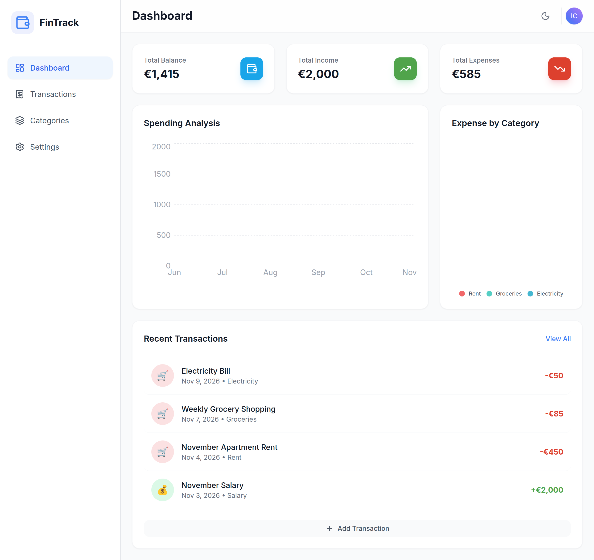
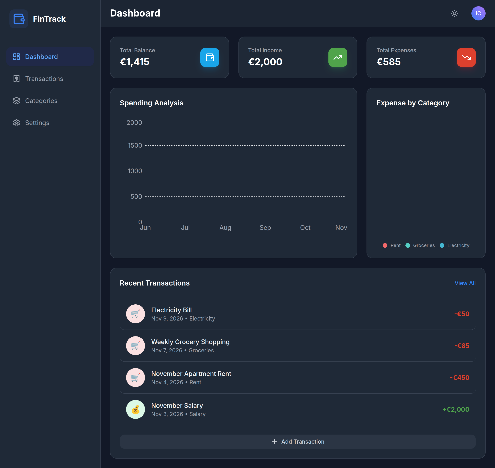
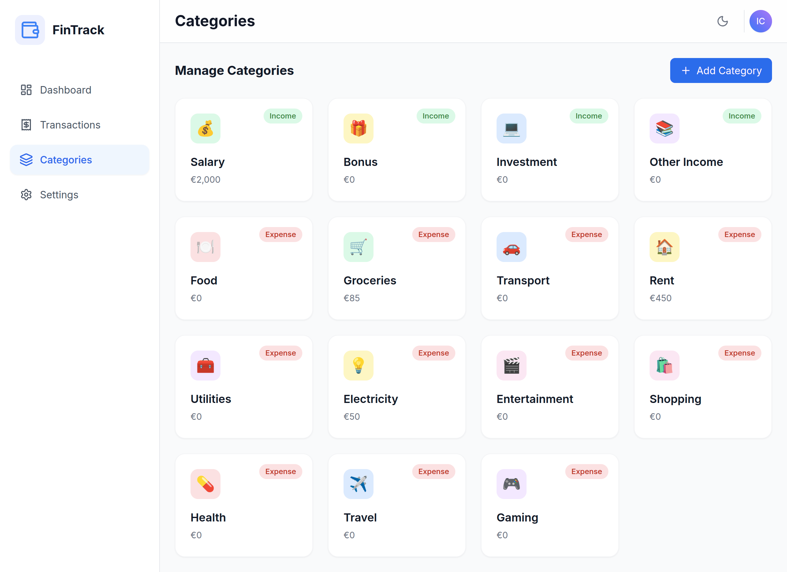
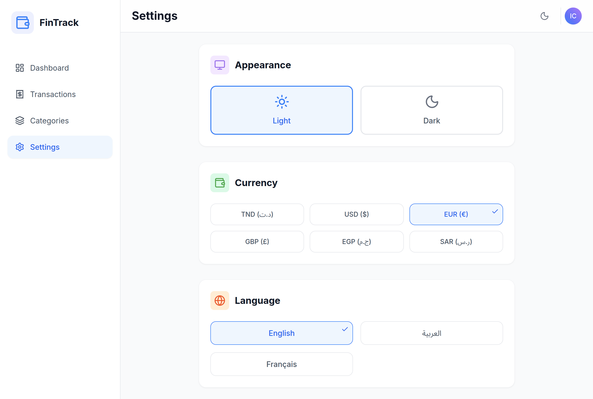
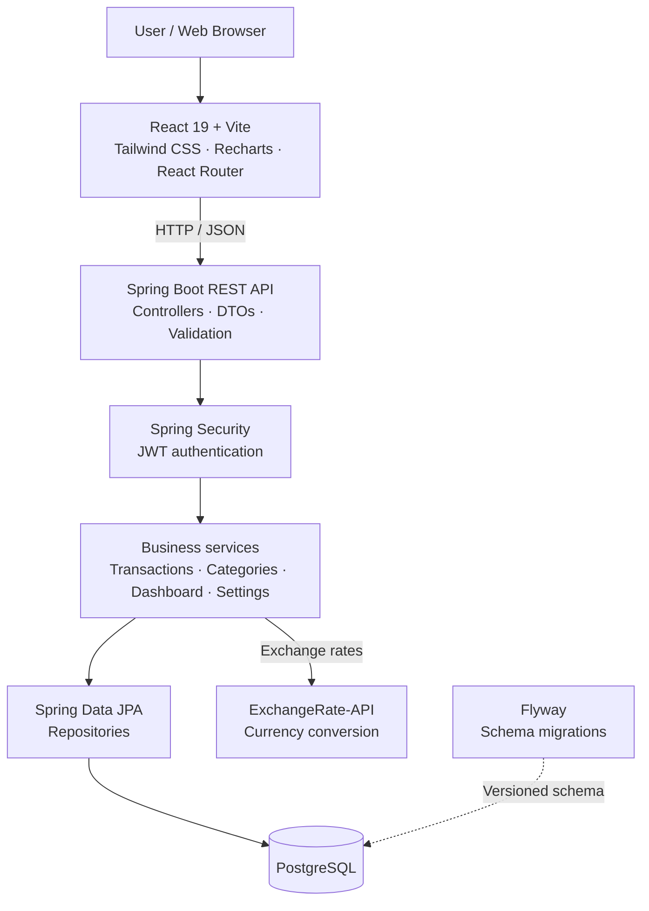

# 💸 FinTrack — Finance Tracking Web App

**A full-stack personal finance dashboard for tracking income, expenses, spending trends, and everyday financial decisions.**

Built with **React 19**, **Spring Boot 3**, and **PostgreSQL**.

[Features](#-features) · [Screenshots](#-screenshots) · [Architecture](#-architecture) · [Getting started](#-getting-started) · [API](#-api-overview)


---

## ✨ Overview

FinTrack brings day-to-day personal finance management into one responsive application. Record transactions, organize them into income and expense categories, understand trends through interactive charts, and personalize the experience with multiple currencies, languages, and themes.

The system pairs a **React single-page application** with a **Spring Boot REST API**. User-specific records are stored in **PostgreSQL**, authentication uses **JWT**, and database schema changes are handled through **Flyway migrations**.

## 🚀 Features

| Area | Capabilities |
| --- | --- |
| **Financial dashboard** | Total balance, income and expenses, recent transactions, six-month income/expense trends, and category-based spending charts. |
| **Transactions** | Create, view, update, and delete income or expense entries; paginated backend endpoint. |
| **Categories** | Browse and create income/expense categories. Category deletion uses archival and reassignment behavior to protect transaction history. |
| **Account access** | User registration, login, and JWT-protected API routes. |
| **Currencies** | EUR, USD, TND, GBP, EGP, and SAR preferences in the current UI, backed by an exchange-rate API integration. |
| **Languages** | English, French, and Arabic; right-to-left page direction for Arabic. |
| **Appearance** | Light and dark themes with responsive layouts. |
| **Developer tooling** | Swagger/OpenAPI documentation, Flyway migrations, and Docker Compose for local PostgreSQL. |

## 📸 Screenshots

> Screenshots are stored in `docs/images/`. They show example data for demonstration purposes.

### Dashboard — light and dark mode

| Light theme | Dark theme |
| :---: | :---: |
|  |  |

### Categories and preferences

| Category management | User settings |
| :---: | :---: |
|  |  |

## 🏗️ Architecture



**Request flow:** The frontend calls REST endpoints through its API service. The backend authenticates requests, validates input, executes business logic, and persists user-specific financial records using JPA repositories. The dashboard exposes aggregated statistics for charts and summaries.

### Repository structure

```text
Finance-Tracking-Web-App/
├── Backend/
│   ├── pom.xml
│   └── src/main/
│       ├── java/com/financetracker/backend/
│       │   ├── controller/       # REST endpoints
│       │   ├── service/          # Business logic
│       │   ├── repository/       # JPA persistence
│       │   ├── model/            # Domain entities
│       │   ├── dto/              # API data contracts
│       │   ├── mapper/           # MapStruct mappings
│       │   ├── security/         # JWT and request security
│       │   ├── config/           # Application configuration
│       │   └── exception/        # Centralized error handling
│       └── resources/
│           ├── application.yml
│           └── db/migration/     # Flyway SQL migrations
├── frontend/
│   ├── package.json
│   └── src/
│       ├── components/
│       ├── context/
│       ├── pages/
│       ├── services/
│       └── utils/
├── docs/images/                  # Local screenshots; add before publishing
├── docker-compose.yml           # PostgreSQL for development
└── README.md
```

## 🛠️ Tech stack

| Layer | Technologies |
| --- | --- |
| **Frontend** | React 19, JavaScript, Vite 7, React Router 7, Tailwind CSS 3, Recharts 3, Axios, Lucide React |
| **Backend** | Java 21, Spring Boot 3.2.1, Spring Web, Spring Security, Spring Data JPA, Jakarta Validation |
| **Mapping and API docs** | MapStruct, springdoc OpenAPI / Swagger UI |
| **Authentication** | JWT (JJWT) |
| **Database** | PostgreSQL, Flyway |
| **Local infrastructure** | Docker Compose |
| **Backend testing dependencies** | Spring Boot Starter Test, Spring Security Test |

## ⚙️ Getting started

### Prerequisites

- Java **21** and Maven
- Node.js compatible with **Vite 7** (Node.js **20.19+** or **22.12+**) and npm
- Docker and Docker Compose, or an independently running PostgreSQL instance
- An **ExchangeRate-API** key for currency conversion

### 1. Clone the repository

```bash
git clone https://github.com/Iyedchaabane/Finance-Tracking-Web-App.git
cd Finance-Tracking-Web-App
```

### 2. Start PostgreSQL

The provided Compose file starts PostgreSQL on port `5432` with a database named `finance_tracker_db`.

```bash
docker compose up -d
```

> **Local development only:** The sample Compose configuration uses example database credentials. Replace them before using the application outside a trusted local environment.

### 3. Configure the backend

Review `Backend/src/main/resources/application.yml` and set the database connection, JWT signing secret, and ExchangeRate-API key for your local environment.

For a production-ready setup, **move secrets to environment variables or a secret manager** rather than keeping real keys in tracked source files. The currently published configuration should be treated as development-only.

### 4. Start the API

From the repository root:

```bash
cd Backend
mvn spring-boot:run
```

The API is configured to run at **http://localhost:8080**. Flyway migrations manage the database schema during startup.

### 5. Start the frontend

In a separate terminal, from the repository root:

```bash
cd frontend
npm install
npm run dev
```

Open the URL printed by Vite (typically **http://localhost:5173**). Register an account or log in to explore the dashboard.

> If your local backend address differs from `http://localhost:8080`, update the frontend API configuration in `frontend/src/services/api.js` to match.

## 📡 API overview

The backend exposes the following endpoint groups. Except for registration and login, requests are subject to the application's authentication rules.

| Feature | Method | Endpoint | Purpose |
| --- | --- | --- | --- |
| Registration | `POST` | `/api/auth/register` | Create a user account |
| Login | `POST` | `/api/auth/login` | Authenticate and receive a JWT |
| Transactions | `GET` / `POST` | `/api/transactions` | List (paginated) / create transactions |
| Transaction details | `PUT` / `DELETE` | `/api/transactions/{id}` | Update / delete a transaction |
| Currency conversion | `GET` | `/api/transactions/{id}/convert?targetCurrency=USD` | Convert a transaction amount |
| Categories | `GET` / `POST` | `/api/categories` | List / create categories |
| Category archive | `DELETE` | `/api/categories/{id}` | Remove a category with history-preserving reassignment |
| Dashboard totals | `GET` | `/api/dashboard/stats` | Retrieve balance, income and expense summary |
| Expense breakdown | `GET` | `/api/dashboard/expense-by-category` | Retrieve expenses grouped by category |
| Monthly analysis | `GET` | `/api/dashboard/monthly-analysis` | Retrieve six-month income/expense analysis |
| Preferences | `GET` / `PUT` | `/api/settings` | Read / update user preferences |

Interactive API documentation is configured at **http://localhost:8080/swagger-ui.html**. The OpenAPI JSON endpoint is **http://localhost:8080/v3/api-docs**.

## 🔐 Security and data handling

- **JWT-based authentication:** The backend uses Spring Security and a JWT authentication filter to protect user-facing data operations.
- **User-specific financial data:** The service and repository layers are designed around the current authenticated user.
- **Input validation:** Request DTOs are validated using Jakarta Validation.
- **Data integrity:** Category removal preserves transaction history through reassignment/archival behavior; Flyway manages schema changes.
- **Secrets:** Never commit real API keys, JWT secrets, or production database passwords. **Rotate the credentials currently present in the published `application.yml`** and replace hard-coded values with secure configuration before deployment.

## 🧪 Development commands

```bash
# Backend tests
cd Backend
mvn test

# Frontend lint
cd frontend
npm run lint

# Frontend production build
npm run build

# Stop the local database container (from repository root)
docker compose down
```

These commands are available from the project configuration; passing test/build results are **not claimed** here.

## 🗺️ Possible next steps

Ideas for continued development include automated CI checks, backend integration tests with a disposable PostgreSQL instance, secure environment-based configuration, and additional transaction filtering and reporting. These are improvement ideas, **not** currently advertised as completed features.

## 📄 License

No root `LICENSE` file was present in the reviewed GitHub repository. Until a license is added, do not assume third-party reuse rights.

---

**FinTrack — understand where your money goes.**

[View source on GitHub](https://github.com/Iyedchaabane/Finance-Tracking-Web-App)
